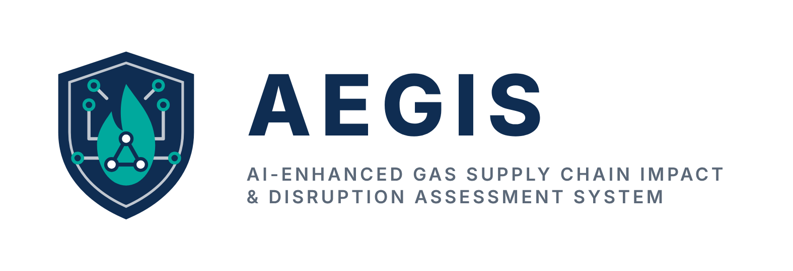

<p align="center">
  
</p>

# AEGIS: AI-Assisted Gas Supply Chain Impact Monitoring and Analysis System

**AEGIS** (AI-Enhanced Gas Supply Chain Impact & Disruption Assessment System) is a Final Year Project that monitors a
natural-gas supply chain from the gas field to three downstream plants. It finds abnormal operating conditions, identifies
what kind of disruption caused them, estimates how badly each downstream plant is affected, and explains every decision.
The results are presented in an interactive Streamlit dashboard for historical analysis and decision support.

> The system is an **offline, advisory** tool. It analyses historical hourly data and suggests monitoring or escalation
> steps; it never controls equipment. All data is **synthetic**, because real industrial data is confidential.

The full FYP I report draft is in [FYP_Report_Draft.md](FYP_Report_Draft.md).

---

## Objectives

1. Build an integrated monitoring framework by combining upstream, midstream and downstream data into one dataset.
2. Develop an AI-based anomaly detection model that identifies abnormal operating conditions across the supply chain.
3. Assess the impact of detected disruptions on downstream facilities and present the insights in an interactive dashboard.

---

## The supply chain being monitored

```
  Upstream            Midstream                 Downstream plants (share of pipeline gas)
  gas field   ──►   pipeline + compressor   ──►   LNG plant            50%
  (pressure,         (pipeline flow,              COGEN / power plant  30%
   flow)              compressor load)            PCG petrochemical    20%
```

Five disruption types are simulated, each with a physical cause:

| Disruption | Where | What happens |
|---|---|---|
| Low Pressure | Upstream | Field pressure falls, so less gas enters the pipeline (supply drops by about half) |
| Compressor Trip | Midstream | The compressor stops, so pipeline flow collapses to almost zero |
| LNG / COGEN / PCG Underperformance | One downstream plant | That plant's efficiency falls while its gas supply stays normal |

Upstream and midstream faults travel down the chain and reduce every plant's output; plant faults stay local.

---

## How it works

```
Hourly sensor data (13 readings per hour)
   │
   ├─► 1. Isolation Forest ............ is this hour unusual?           (unsupervised anomaly detection)
   ├─► 2. 2-hour persistence filter ... did it stay unusual 2+ hours?   (removes one-hour noise spikes)
   ├─► 3. XGBoost ..................... which disruption is it?         (6 classes: Normal + 5 disruptions)
   ├─► 4. Impact rules ................ how badly is each plant hit?    (weighted by each plant's gas share)
   └─► 5. SHAP ........................ which sensors drove the result? (explainable AI)
                                         │
                                         ▼
                              Streamlit dashboard (app.py)
```

- **Confirmed disruption:** an Isolation Forest anomaly that persists for **2 or more consecutive hours**. Single-hour
  spikes are filtered out as noise.
- **System severity:** for supply faults, *High* if pipeline supply drops by 75% or more and *Medium* if it drops by 25%
  or more. For a plant fault, the severity is that plant's own impact level.
- **Monitoring advisory:** a suggested next step for each severity (for example, "escalate to operations planner").
  It is advice only.

---

## Dataset

| Item | Value |
|---|---|
| Source | Synthetic, generated by `dataset/realistic_dataset.py` (fixed seed, reproducible) |
| Period | 1 Jan 2025 to 31 Dec 2025, one row per hour (8,760 rows) |
| Disruptions | 18 events per type (90 events, 5 to 7 hours each, at least 20 hours apart) |
| Abnormal hours | 552 of 8,760 (6.3%) |
| Realism | Sensor noise, gradual ramp-in and recovery hours, and 20 harmless one-hour dips that are labelled Normal |
| Train / test split | Time-ordered 70 / 30: training up to 13 Sep 2025, testing on the last 2,628 hours (13 Sep to 31 Dec 2025) |

---

## Results (test period, 2,628 hours)

**Anomaly detection (Isolation Forest)**

| | Precision | Recall | F1 | ROC-AUC | False-positive hours | Events detected |
|---|---|---|---|---|---|---|
| Raw | 0.764 | 0.909 | 0.830 | 0.997 | 34 | 20 / 20 |
| **+ 2-hour persistence filter** | **0.974** | **0.909** | **0.940** | 0.997 | **3** | **20 / 20** |

The 2-hour filter cuts false positives from 34 to 3 without missing a single disruption event. Isolation Forest also
clearly beats the two baselines tested (Local Outlier Factor and an MLP autoencoder).

**Disruption classification (6 classes)**

| Model | Accuracy | Macro F1 | Inference time |
|---|---|---|---|
| **XGBoost (used)** | 0.9985 | 0.975 | 6 ms |
| Random Forest | 0.9992 | 0.979 | 31 ms |
| SVM (RBF) | 0.9989 | 0.971 | 27 ms |

XGBoost is 4 to 5 times faster than the baselines with near-identical accuracy, and it works directly with SHAP's
fast tree explainer. SHAP confirms that each disruption is recognised from the sensors at the right stage of the chain,
for example upstream pressure and flow for Low Pressure, and compressor load and pipeline flow for Compressor Trip.

**Impact rules:** moving every severity cut-off by ±15% changes the severity of 39 (−15%) or 13 (+15%) of the 126
anomalous test hours, so the ratings are reasonably stable.

---

## Dashboard

Run `streamlit run app.py` and use the sidebar to move between pages:

| Page | What it shows |
|---|---|
| **Supply Chain Overview** | Summary cards and hourly telemetry for upstream, midstream and downstream. Red dots mark confirmed disruptions at that stage; orange rings show the knock-on effect of a disruption further up the chain. |
| **Event Inspector** | Pick a confirmed disruption hour to see the 5-stage chain, the AI diagnosis with its SHAP explanation, the impact on each plant and the monitoring advisory. |
| **Disruption Logs** | Every confirmed disruption event, with an hourly breakdown, CSV downloads and a check of how stable the severity rules are. |
| **Upload & Score** | Upload a new hourly CSV in the same format as the master dataset. It is scored by the trained models (no retraining) and can then be explored in the three pages above. |
| **Model Performance** | Detection and classification results, confusion matrix, per-class scores and global SHAP feature importance. |

---

## Getting started

Requires **Python 3.14** (the versions in `requirements.txt` were tested with it).

```bash
# 1. Create and activate a virtual environment
python -m venv .venv
.venv\Scripts\activate            # Windows
# source .venv/bin/activate       # macOS / Linux

# 2. Install the packages
pip install -r requirements.txt

# 3. Start the dashboard (from the project root)
streamlit run app.py
```

The trained models and results are already included in `Models/result/`, so the dashboard runs straight away.

**To rebuild everything from scratch** (new data, retrained models, new results):

```bash
cd dataset
python realistic_dataset.py     # 1. generate the 5 stage datasets
python Merge.py                 # 2. merge them into master_gas_supply_chain_dataset.csv
cd ..
python Models/Train_Anomaly.py      # 3. train Isolation Forest + baselines
python Models/Train_Classifier.py   # 4. train XGBoost + baselines
python Models/ImpactAssessment.py   # 5. impact assessment + SHAP, writes the dashboard files
```

`Merge.py` must be run from inside `dataset/`, because it reads and writes files in the current folder.

`Models/Visualization.ipynb` contains extra charts for analysing detection results.

---

## Project structure

```
├── app.py                          Streamlit dashboard
├── requirements.txt                Python packages
├── .streamlit/config.toml          Dashboard theme and font
├── Picture/                        Logos (sidebar logo, browser-tab icon, README logo)
├── dataset/
│   ├── realistic_dataset.py        Generates the official dataset (noise, ramps, transients)
│   ├── Dataset.py                  Earlier, noise-free version of the generator
│   ├── Merge.py                    Merges the 5 stage files into the master dataset and adds labels
│   ├── *_dataset.csv, downstream_*.csv, master_gas_supply_chain_dataset.csv
│   └── 1st_dataset/                Backup of the first dataset version
└── Models/
    ├── Train_Anomaly.py            Isolation Forest (+ LOF, autoencoder baselines) and the 2-hour filter
    ├── Train_Classifier.py         XGBoost (+ Random Forest, SVM baselines) and a stress test
    ├── ImpactAssessment.py         Impact scores, severity, advisory, SHAP, sensitivity check
    ├── impact_rules.py             Impact and severity rules (shared by the scripts and the dashboard)
    ├── scoring.py                  Scores new data with the trained models (used by Upload & Score)
    ├── Visualization.ipynb         Detection analysis charts
    └── result/                     Trained models (.pkl) and result files read by the dashboard
```

---

## Limitations and future work

- **Synthetic data:** the models learned "normal" from simulated values. Data from a real plant with different normal
  operating levels would need the models to be retrained (and the impact rules' baselines updated) first.
- **Historical analysis only:** the dashboard analyses past data. Real-time streaming and alerting are future work.
- **The 2-hour filter adds a 1-hour delay** before a disruption is confirmed, and a noise spike directly next to a
  real event can be counted as part of that event.
- **Future work:** integration of real industrial operational data, real-time data streaming, and more advanced
  impact-propagation models.

---

*Final Year Project by Syed Muhammad Arif.*
